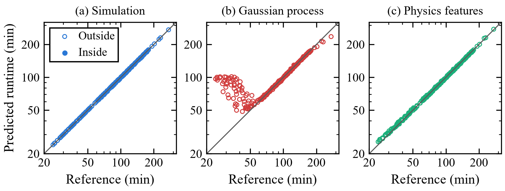
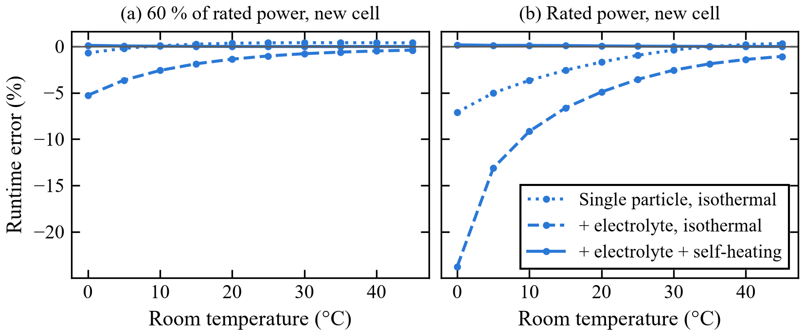
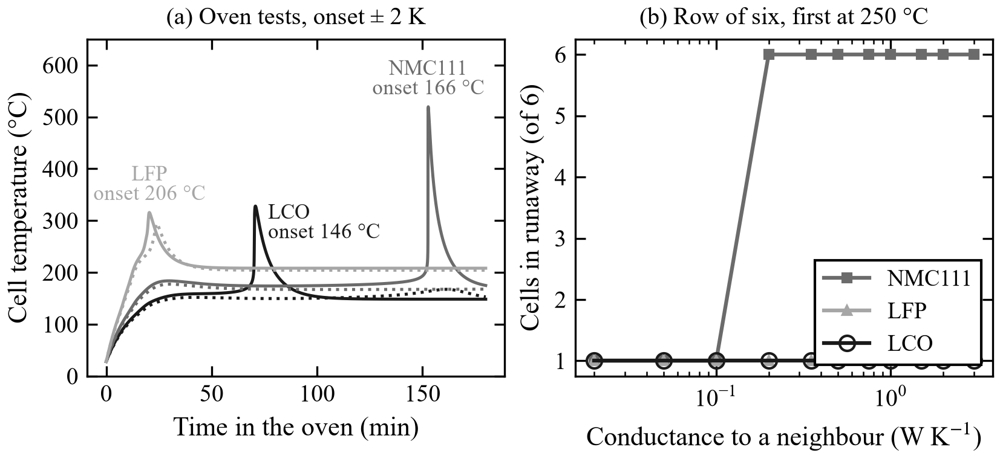

# UPS-Battery-Prediction

[](https://github.com/Shuruyue/UPS-Battery-Prediction/actions/workflows/ci.yml)


**[Interactive page](https://shuruyue.github.io/UPS-Battery-Prediction/web/ups-battery.html)**: set the room temperature, the load and the age of the battery and compare the runtime a formula, a simulation and five learned models predict, or put a cell in an oven and watch it run away. Inside the conditions they were trained on, gradient boosting, a neural network and a Gaussian process have mean runtime errors of 0.5–1.8 %; outside, their errors are 46–116 %, against 3.9 % for a two-point formula, and their 90 % intervals keep claiming 90 % confidence.

[](https://shuruyue.github.io/UPS-Battery-Prediction/web/ups-battery.html)

*Mean absolute error of the predicted runtime against the distance of the test point from the training range, pooled over 20 random splits. The learned models (red) are accurate inside the range and diverge outside it; the formula and the physics features degrade slowly. The simulation shares its parameters with the reference, so its error is a best case (see Limitations).*

## Backup-Battery Runtime and Thermal-Runaway Models

How long will the battery of an uninterruptible power supply (UPS) last when the mains fail, and can it catch fire? This project answers the first question with three kinds of tool, a formula, a physical simulation and machine learning, and scores all of them against one reference, inside and outside the conditions the tools were built for. A separate four-reaction thermal-runaway model answers the second question.

The reference ("reality") is the Doyle–Fuller–Newman (DFN) model with a lumped thermal model, solved with [PyBaMM](https://pybamm.org) using the LG M50 parameters of O'Regan et al. (2022). Every result quoted below is computed by `ups_battery_prediction/summary.py` from `results/*.json`, and `scripts/validate.py` checks that the README still quotes what the results give.

Temperatures are in °C, loads are shares of the rated 18 W per cell, runtimes are in minutes, and the state of health (SOH) is the low-rate capacity as a share of that of the new cell.

## Project Overview

### Core Features

- **Reference** — PyBaMM DFN with a lumped thermal model at 418 operating points: a Sobol design of the normal range, a Sobol design of a wider box and four one-at-a-time sweeps, on a mesh chosen by an audit.
- **Simulation** — single-particle model with electrolyte (SPMe) and the same lumped thermal model, written from scratch in NumPy: finite volumes with Kirchhoff-transform face diffusivities, many operating points per solve, constant power by Newton iteration.
- **Formula** — Peukert's law through two rated points, as read from a datasheet.
- **Machine learning** — six scikit-learn regressors trained on 150 noisy discharges from the normal range, a linear model on physics features and the simulation corrected by data; split-conformal 90 % intervals; 20 random splits; learning curves.
- **Ageing** — loss of lithium inventory to the SEI, with the film resistance it adds.
- **Thermal runaway** — lumped four-reaction abuse model of an 18650 cell with LiCoO2, NMC111 and LiFePO4 cathodes and an adaptive implicit integrator written here: oven tests, onset temperatures, propagation along a row of cells, internal short.
- **Validation** — 29 automated checks and 3 reported observations, plus unit tests and a check of the page's JavaScript, run in CI on every push.

## Quick Start

### Installation

```bash
git clone https://github.com/Shuruyue/UPS-Battery-Prediction.git
cd UPS-Battery-Prediction
pip install -e ".[dev]"            # add ",reference" for PyBaMM, needed only to regenerate the reference
```

### Usage

```bash
python scripts/summary.py         # the main results, computed from results/*.json
python scripts/make_figures.py    # all figures → docs/figures/
```

```python
from ups_battery_prediction import discharge, thermal_runaway as tr

r = discharge.simulate(273.15, soh=1.0, power=18.0)     # 0 °C, new cell, rated power, SPMe + heat
print(r["runtime_s"][0] / 60, r["T_max_K"][0] - 273.15) # 50.17  25.71

t, y, s = tr.oven_test(tr.LCO, 150 + 273.15)            # 18650 LiCoO2 cell in an oven at 150 °C
print(s["runaway"], s["t_runaway_s"] / 60)              # True  55.3
```

### Validation Scripts

```bash
pytest -q                               # unit tests; parameters against PyBaMM and the page's JavaScript when installed
python scripts/validate.py --markdown   # checks on results/*.json and README.md → VALIDATION.md
python scripts/verify_web_page.py       # JavaScript of the interactive page against the package (needs Node.js)
```

`scripts/validate.py` exits with code 1 if any check fails. The full table is in [VALIDATION.md](VALIDATION.md).

### Reproducing the results

The results in `results/` come from these scripts, run from the repository root. They were produced with PyBaMM 26.10.1.1.

| Step | Command | Time |
|---|---|---|
| Mesh audit of the reference | `python scripts/audit_reference_mesh.py --workers 4` | ~1 h |
| Reference (418 DFN runs) | `python scripts/gen_reference.py --workers 4` | ~2 h with 4 workers |
| Own model at the design points and on a grid | `python scripts/gen_model_points.py`, `python scripts/gen_model_grid.py` | ~30 min |
| Code and model-form checks against PyBaMM | `python scripts/verify_pybamm.py` | ~40 min |
| Convergence, self-heating, sensitivity | `python scripts/convergence.py`, `python scripts/thermal_effect.py`, `python scripts/perturb_model.py` | ~1 h |
| Machine-learning experiment | `python scripts/run_ml.py --workers 8` | ~15 min |
| Thermal runaway | `python scripts/verify_runaway.py`, `python scripts/run_runaway_scenarios.py` | ~20 min |
| Figures, page, validation table | `python scripts/make_figures.py`, `python scripts/build_web_page.py`, `python scripts/validate.py --markdown` | ~3 min |

Set `OMP_NUM_THREADS=1` when several scripts run at once. Each PyBaMM worker holds about 1.3 GB of memory; choose the number of workers from the free memory, not the number of cores.

## Project Structure

```text
UPS-Battery-Prediction/
├── ups_battery_prediction/
│   ├── params.py           # LG M50 parameters (O'Regan 2022, Chen 2020, Landesfeind 2019)
│   ├── ageing.py           # state of a fully charged cell at a given state of health
│   ├── numerics.py         # particle and electrolyte finite volumes, tridiagonal solver
│   ├── discharge.py        # SPM / SPMe, isothermal / lumped, constant current or power
│   ├── thermal_runaway.py  # four-reaction abuse model, adaptive implicit integrator
│   ├── design.py           # operating points of the experiment
│   ├── reference.py        # the PyBaMM reference (DFN + lumped thermal)
│   ├── results.py          # reading and writing results/*.json
│   ├── predictors.py       # Peukert, learned models, physics features, conformal intervals
│   ├── experiment.py       # formula vs simulation vs machine learning
│   ├── validation.py       # checks behind VALIDATION.md (run_all)
│   ├── summary.py          # every number quoted in this README (compute)
│   └── plotting.py         # figures (14 cm wide, 300 dpi)
├── scripts/                # command-line entry points (see Reproducing the results)
├── tests/                  # pytest
├── results/                # JSON output of the scripts
├── docs/figures/           # figures of this README
├── web/                    # interactive page (GitHub Pages); web/src holds its sources
└── VALIDATION.md           # check-by-check validation table
```

## Theoretical Background

### Single-particle model with electrolyte (SPMe)

Each electrode $k$ is represented by one spherical particle in which lithium diffuses; $`\theta_k = c_k/c_{k,\max}`$ is its stoichiometry:

```math
\frac{\partial \theta_k}{\partial t} = \frac{1}{r^2}\frac{\partial}{\partial r}\left(r^2 D_k(\theta_k,T)\,\frac{\partial \theta_k}{\partial r}\right),\qquad
-D_k\frac{\partial \theta_k}{\partial r}\bigg|_{r=R_k} = \pm\frac{I}{F\,a_k L_k A\,c_{k,\max}}
```

(+ for the negative electrode, which gives up lithium during discharge). The salt concentration across the cell follows

```math
\varepsilon\frac{\partial c_e}{\partial t} = \frac{\partial}{\partial x}\left(\varepsilon^{b} D_e(c_e,T)\,\frac{\partial c_e}{\partial x}\right) + \frac{1}{F}\frac{\partial}{\partial x}\Big[\big(1-t^{+}(c_e,T)\big)\,i_e\Big],
```

where the electrolyte current density $`i_e`$ rises linearly from 0 to $I/A$ across the negative electrode, is $I/A$ in the separator and falls back to 0 across the positive electrode: the reaction is spread evenly over each electrode, which is the single-particle assumption. The terminal voltage is

```math
V = U_p(\theta_{p,s},T) - U_n(\theta_{n,s},T) - \bar\eta_n - \bar\eta_p + \Delta\phi_e + \Delta\phi_s - I R_\mathrm{film}
```

```math
\eta_k = \frac{2RT}{F}\,\mathrm{asinh}\frac{I/(a_k L_k A)}{2\,j_{0,k}(\theta_{k,s},c_e,T)},\qquad
\frac{\partial\phi_e}{\partial x} = \chi(c_e,T)\,\frac{RT}{F}\,\frac{\partial\ln c_e}{\partial x} - \frac{i_e}{\varepsilon^{b}\kappa_e(c_e,T)},\qquad
\Delta\phi_s = -\frac{I}{A}\left(\frac{L_n}{3\sigma_n}+\frac{L_p}{3\sigma_p}\right)
```

with $`\chi = 2(1-t^{+})(1+\mathrm{d}\ln f/\mathrm{d}\ln c)`$, the overpotentials $`\bar\eta_k`$ averaged over each electrode, $`\Delta\phi_e`$ the mean electrolyte potential of the positive electrode minus that of the negative one, and $`U(\theta,T) = U_\mathrm{ref}(\theta) + (T-T_\mathrm{ref})\,\partial U/\partial T`$. Diffusivities, exchange currents and the positive-electrode conductivity follow Arrhenius laws (Marquis et al. 2019; O'Regan et al. 2022).

The electrolyte potential is integrated with $`\chi`$ and $`\kappa_e`$ at the local concentration, the "integrated" form of Brosa Planella et al. (2021). PyBaMM's SPMe evaluates both at the x-averaged concentration, which PyBaMM reports as 1036 mol m⁻³ when the concentration is 1000 mol m⁻³ everywhere (`tests/test_params.py` reproduces this). The code check against PyBaMM therefore uses a parameter variant in which neither property depends on concentration; there the two forms are the same equations.

### Lumped thermal model

```math
C(T)\,\frac{dT}{dt} = I\,(U_p-U_n-V) + I\,T\left(\frac{\partial U_n}{\partial T}-\frac{\partial U_p}{\partial T}\right) - hA_\mathrm{cool}\,(T-T_\mathrm{amb})
```

The first term is all irreversible heat (reaction, ohmic, electrolyte polarisation, SEI film), the second the reversible (entropic) heat; $`C = \rho c_{p,\mathrm{eff}}(T)\,V_\mathrm{cell}`$ as in PyBaMM's lumped model. The cell starts at the ambient temperature. The isothermal model, which holds the cell at the ambient temperature, is the limit $`h\to\infty`$.

### Numerics

Finite volumes with 30 cells per particle and 20/10/20 cells across the negative electrode, separator and positive electrode; backward-Euler steps of 1 s with the coefficients of the previous step. The new state is then linear in the current, so the current of a constant-power step follows from Newton iteration on $`I\,V(I) = P`$. Both solid diffusivities change by orders of magnitude within narrow stoichiometry windows, and the face diffusivities come from the Kirchhoff transform, which gives the exact flux of a steady front between two cells:

```math
D_{i+1/2} = \frac{\Phi(\theta_{i+1})-\Phi(\theta_i)}{\theta_{i+1}-\theta_i},\qquad \Phi(\theta) = \int_0^{\theta} D_\mathrm{ref}(\theta')\,d\theta'
```


*Runtime of the single-particle model at 0 °C and 2C against the number of radial points, relative to PyBaMM's SPM on its finest grid. With Kirchhoff-transform faces this code is converged on a coarse grid; PyBaMM's default of 20 points is far from converged in this case.*

### Ageing

Ageing is loss of lithium inventory (LLI) to the SEI on the negative electrode, the dominant mode for cells kept on float charge at moderate temperature. The lost lithium thickens the SEI (two Li per SEI molecule), which adds a film resistance in series:

```math
n_\mathrm{Li} = (1-\mathrm{LLI})\,n_\mathrm{Li,new},\qquad
\delta_\mathrm{SEI} = \delta_0 + \frac{\mathrm{LLI}\;n_\mathrm{Li,new}\,\bar V_\mathrm{SEI}}{2\,a_n L_n A},\qquad
R_\mathrm{film} = \frac{\rho_\mathrm{SEI}\,\delta_\mathrm{SEI}}{a_n L_n A}
```

LLI is chosen so that the low-rate capacity between full charge (the open-circuit voltage of the new cell) and 2.5 V is SOH times that of the new cell.

### Formula and learned models

Peukert's law with a capacity factor, $`t = t_\mathrm{rated}\,\mathrm{SOH}\,L^{-k}`$, with $`t_\mathrm{rated}`$ and $k$ from the reference at 25 °C, new cell, 50 % and 100 % load. The physics features fit $`\ln t = a + b\ln L + c\ln\mathrm{SOH} + d/T`$ by least squares; the simulation corrected by data is $`t = t_\mathrm{sim}\exp g(T,L,\mathrm{SOH})`$ with $g$ a ridge regression fitted to $`\ln(t_\mathrm{meas}/t_\mathrm{sim})`$. The training "measurements" are reference runtimes with 2 % log-normal noise. Each of 20 random splits takes 56 test, 150 training and 50 calibration points from the normal range.

The 90 % intervals are split-conformal (Lei et al. 2018) on the relative residual:

```math
r_i = \frac{|y_i-\hat y_i|}{\hat y_i}\ \text{on } n = 50 \text{ calibration points},\qquad
q = r_{(k)},\quad k = \lceil (n+1)(1-\alpha)\rceil = 46,\qquad
\text{interval } \hat y\,(1\pm q)
```

For a new point exchangeable with the calibration points the coverage is $k/(n+1) = 46/51 = 0.902$. Points outside the training range are not exchangeable with them, and nothing guarantees coverage there.

### Thermal runaway

Four exothermic reactions (Hatchard et al. 2001; Kim et al. 2007):

```math
\frac{dc_\mathrm{sei}}{dt} = -A_\mathrm{sei}\,e^{-E_\mathrm{sei}/RT}\,c_\mathrm{sei},\qquad
\frac{dc_\mathrm{neg}}{dt} = -A_\mathrm{ne}\,e^{-t_\mathrm{sei}/t_\mathrm{ref}}\,e^{-E_\mathrm{ne}/RT}\,c_\mathrm{neg},\qquad
\frac{d\alpha}{dt} = A_\mathrm{pe}\,\alpha(1-\alpha)\,e^{-E_\mathrm{pe}/RT},\qquad
\frac{dc_e}{dt} = -A_e\,e^{-E_e/RT}\,c_e
```

with $`dt_\mathrm{sei}/dt = -dc_\mathrm{neg}/dt`$, and the energy balance of a lumped cell

```math
\rho c_p V\,\frac{dT}{dt} = V\sum_j H_j W_j R_j - hA\,(T-T_\mathrm{amb}) - \epsilon\sigma A\,(T^4-T_\mathrm{amb}^4) + Q_\mathrm{ext} + Q_\mathrm{neighbours}
```

The equations are integrated with an adaptive backward-Euler method (Newton iteration, step size from the difference between an explicit predictor and the implicit result), checked against SciPy's Radau. The onset temperature is the lowest oven temperature at which the cell runs away, found by bisection.

## Parameters

| Parameter | Value | Source |
|---|---|---|
| Cell | LG M50, 21700, NMC811 / graphite-SiOx, 5 A h | [1, 2] |
| Parameter functions (OCPs, diffusivities, exchange currents, conductivities, entropic coefficients, heat capacities) | PyBaMM's `ORegan2022` set, every function checked by `tests/test_params.py` | [1, 2, 3] |
| Electrode / separator thickness | 85.2 / 12 / 75.6 µm | [2] |
| Particle radius, negative / positive | 5.86 / 5.22 µm | [2] |
| Electrolyte | LiPF6 in EC:EMC 3:7 | [3] |
| Lower cut-off voltage | 2.5 V | [1] |
| Heat-transfer coefficient $h$ | 10 W m⁻² K⁻¹ | PyBaMM's value for this set; assumed for a cell in a UPS cabinet |
| Cooling area, cell volume | 53.1 cm², 24.2 cm³ | [1] |
| SEI molar volume, resistivity, initial thickness | 9.585 × 10⁻⁵ m³ mol⁻¹, 2 × 10⁵ Ω m, 5 nm | PyBaMM's `Chen2020` set, after [12] |
| Rated load | 18 W per cell (56 cells in series, about 1 kW) | assumed example system |
| Training range of the learned models | 18–28 °C, 30–80 % load, SOH 0.9–1.0 | design of this study |
| Wider box | 0–45 °C, 20–150 % load, SOH 0.7–1.0 | design of this study |
| Measurement noise of the training data | 2 %, log-normal | assumed |
| Abuse kinetics: $A$, $E$, $H$ of the four reactions, initial contents | as in `thermal_runaway.Chemistry` | [8]; cathodes of NMC111 and LiFePO4 [9] |
| Carbon, cathode and electrolyte contents $`W_c`$, $`W_p`$, $`W_e`$ (LiCoO2) | 610, 1300, 406 kg m⁻³ | [8] (see Limitations) |
| 18650 cell: radius, height, $`\rho c_p`$ | 9 mm, 65 mm, 2.789 MJ m⁻³ K⁻¹ | [8] |
| Oven tests: $h$, start temperature | 7.17 W m⁻² K⁻¹, 28 °C | [10] |
| Surface emissivity | 0.8 | [7], as cited by [11] |

## Key Results

Example system: 56 cells in series, 1.02 kWh, rated load 18 W per cell (about 1 kW). Dividing energy by power gives 60.5 min; the reference gives 53.7 min at 25 °C and 50.1 min at 0 °C.

Mean absolute percentage error of the predicted runtime (20 random splits):

| Predictor | Inside the training range | Outside |
|---|---|---|
| Peukert formula | 0.8 % | 3.9 % |
| Simulation (SPMe + heat, no fitting) | 0.01 % | 0.04 % |
| Gradient boosting | 1.8 % | 46.5 % |
| Neural network | 1.7 % | 115.7 % |
| Gaussian process | 0.5 % | 61.8 % |
| Linear model on physics features | 0.3 % | 2.1 % |
| Simulation + data correction | 0.2 % | 0.4 % |

"Outside" is the part of the wider box that lies outside the training range (121 points).

**The learned models do not know when they are wrong.** A 90 % conformal interval calibrated inside the training range covers 89–92 % of the inside test points and 6–34 % of the outside points for the six purely data-driven models. With the physics in the model the same procedure covers 71 % (physics features) and 89 % (simulation corrected by data).


*Share of the test points inside the 90 % conformal interval, mean of 20 random splits. Grey: inside the training range, where every model reaches the nominal coverage; coloured: outside it. Dashed: 90 %.*


*Reference (dots) and the predictions of one split along (a) the temperature sweep at rated load and (b) the state-of-health sweep at 60 % load and 25 °C. Shaded: the training range.*



*Predicted against reference runtime for one split: (a) simulation, (b) Gaussian process, (c) physics features. Filled: test points inside the training range; open: points outside it.*

**A cold room costs much less runtime than an isothermal model says.** Held at the room temperature, the reference lasts 36.7 min at 0 °C and rated load; a cell that heats itself (cooled by 10 W m⁻² K⁻¹ over its surface) lasts 50.1 min and ends at 27 °C. At 25 °C the difference is small: 53.7 min against 51.7 min, ending at 41 °C. How much the self-heating helps depends on how well the cabinet removes heat: 52.4 min with almost no cooling (2 W m⁻² K⁻¹), 42.9 min with strong cooling (100 W m⁻² K⁻¹). Scored against the self-heating reference on the outside points, the single-particle model held at room temperature is off by 3.6 %, the same model with the electrolyte by 9.4 % (an isothermal cold cell at heavy load runs out of electrolyte salt in the SPMe, which the warming cell of the reference does not), and the model with the electrolyte and self-heating by 0.04 %. When the cell is kept cold (0 °C with strong cooling, or isothermal) the SPMe itself overestimates the DFN by 3.1–4.0 %; see [VALIDATION.md](VALIDATION.md).


*(a) Runtime of a new cell at rated load against the heat-transfer coefficient $h$, reference (DFN, black) and simulation (SPMe, blue); ∞ is the isothermal model. (b) Cell temperature at the end of the discharge in the reference.*



*Error of three forms of the simulation against the reference along the temperature sweep of a new cell, (a) at 60 % and (b) at 100 % of rated power.*

**The simulation is favoured here.** It shares every parameter and most of the physics with the reference, so its 0.04 % is a best case, not an estimate of its error against a real cell. Setting one parameter group wrong (solid diffusivities, exchange currents or resistances by 30 %, or the cooling coefficient by a factor of two) moves its outside error to 0.1–2.8 %, and three groups at once to 3.2 % (`scripts/perturb_model.py`): the same order as the formula and the physics features. Against a real battery the parameters would also be uncertain, and physics that neither model contains would add to the error.


*Simulated runtime of a new cell over room temperature and load. Dashed: the training range of the learned models.*

**Can it burn?** The hottest point of the design (45 °C, 147 % load, state of health 0.74) ends at 90 °C, well below the oven onset temperatures of the thermal-runaway model, whose cell (an 18650, not the LG M50) runs away above 146 °C with a LiCoO2 cathode, 166 °C with NMC111 and 206 °C with LiFePO4. The oven tests of Hatchard et al. (2001) on this LiCoO2 cell put the onset between 145 and 150 °C (no runaway at 145 °C, runaway at 150 and 155 °C; Lopez et al. 2015, Fig. 2a).



*(a) Temperature of a cell in an oven 2 K above (solid) and 2 K below (dotted) the onset temperature of each chemistry. (b) Number of cells in a row of six that run away when the first starts at 250 °C, against the thermal conductance between neighbours; LiCoO2 and LiFePO4 coincide at one cell.*

## Correction

Two corrections to results published earlier:

1. **Isothermal reference** (an earlier version of this code, published in a repository that this one replaces). The reference and the simulation held the cell at the room temperature, and for each check against PyBaMM the single-particle model was run with and without a solid ohmic term and the closer result kept. The reference now has a lumped thermal model, the simulation is an SPMe with the same thermal model, and every setting of the checks is fixed in advance.
2. **Conformal quantile one rank too high** (first release of this repository). The interval half-width was the 47th instead of the 46th smallest of 50 calibration residuals, so the intervals were slightly wide; `tests/test_predictors.py` now checks the rank and the coverage of 46/51.

| Quantity | Published | Corrected |
|---|---|---|
| Reference runtime at rated load, 0 °C | 36.7 min (isothermal) | 50.1 min |
| Reference runtime at rated load, 25 °C | 51.7 min (isothermal) | 53.7 min |
| 90 % conformal coverage inside the range, pure machine learning | 91–94 % | 89–92 % |
| 90 % conformal coverage outside, pure machine learning | 7–35 % | 6–34 % |
| 90 % conformal coverage outside, physics features | 74 % | 71 % |
| 90 % conformal coverage outside, simulation + data | 92 % | 89 % |

The conclusions stand: the learned models extrapolate without warning, and a cold room costs less runtime than the isothermal model said.

## Validation

| Category | Checks | Examples |
|---|---|---|
| Reference | 3 | mesh audit: twice the radial and twice the through-cell resolution change the hardest corners by less than 0.2 %; all 418 points solved to 2.5 V |
| Code check against PyBaMM | 7 | our SPM, SPMe and SPMe + heat against PyBaMM's on the same equations, 6 cases C/2–2C, −10 to 25 °C: voltage RMS < 5 mV, runtime < 0.5 %, end temperature < 0.1 K |
| Model form | 1 | SPMe + heat against DFN + heat within 1 % at 9–27 W, 0–25 °C |
| Convergence | 5 | radial grid against PyBaMM's finest; radial, through-cell and time-step refinement in the hardest corner of the design |
| Self-heating | 2 (+ 2 observations) | simulation against reference at the reference's cooling; the gain from self-heating at 0 °C |
| Thermal runaway | 7 (+ 1 observation) | exact adiabatic energy balance; own integrator against SciPy's Radau; Semenov critical temperature; LiCoO2 onset inside the 145–150 °C of the oven tests |
| Experiment | 3 | conformal coverage inside the range; Peukert through its two points; size of the design |
| README | 1 | every number of `summary.compute` appears verbatim in this README |

Unit tests (`pytest`) check the building blocks separately: diffusion in a sphere against the series solution and the steady electrolyte profile against the closed form (both second order in space), conservation of lithium and salt to round-off, the SPMe-to-SPM limit, every parameter function against PyBaMM, the rank and coverage of the conformal interval, and the page's JavaScript thermal-runaway model against the package in Node.js.

## Limitations

- The reference is a model, not a measurement, and it shares its parameters with the simulation. No measured discharge data of the LG M50 at low temperature were used.
- The heat-transfer coefficient (10 W m⁻² K⁻¹, PyBaMM's value for this parameter set) is assumed for a cell inside a UPS cabinet, and the room temperature is held constant during the outage. Neighbouring cells, which warm each other, are not modelled in the runtime part.
- The formula is calibrated on the noise-free reference at 100 % load, which lies outside the training range of the learned models, as a datasheet point would; part of its advantage outside the range comes from that point.
- Ageing is loss of lithium inventory plus an SEI film resistance; loss of active material, particle cracking and lithium plating are not represented. All the lost lithium goes into the SEI, which at a state of health of 0.7 makes the film 0.81 µm thick with a resistance of 48 mΩ; measured SEI films are tens of nanometres thick, so the film stands for all the resistance growth of the aged cell rather than for a real layer.
- The UPS is reduced to one cell at constant power. Inverter efficiency, the spread between the cells of a series string (the weakest cell reaches the cut-off first) and the battery-management system are not simulated.
- The measurement noise of the training data (2 %, log-normal) is assumed.
- The thermal-runaway part uses an 18650 LiCoO2 cell (Kim et al. 2007) because its abuse kinetics are published as a complete set; NMC111 and LiFePO4 change only the cathode reaction, and no NMC811 kinetics of this form were found. It is lumped and has no venting, so onset temperatures and timing are its reliable outputs and peak temperatures run high. The carbon and electrolyte contents $`W_c`$ and $`W_e`$ could not be checked against Kim et al. (2007), which is not open access; Lopez et al. (2015), Table 1, list 1.39 × 10³ and 5.0 × 10² kg m⁻³ for the same cell, with which the same model puts the LiCoO2 onset at 134 °C instead of 146 °C, below the oven tests.

## References

1. K. O'Regan, F. Brosa Planella, W. D. Widanage, E. Kendrick, *Electrochim. Acta* **425**, 140700 (2022). [doi:10.1016/j.electacta.2022.140700](https://doi.org/10.1016/j.electacta.2022.140700) — LG M50 thermal-electrochemical parameters (CC BY 4.0).
2. C.-H. Chen et al., *J. Electrochem. Soc.* **167**, 080534 (2020). [doi:10.1149/1945-7111/ab9050](https://doi.org/10.1149/1945-7111/ab9050) — open-circuit potentials and geometry (CC BY 4.0).
3. J. Landesfeind, H. A. Gasteiger, *J. Electrochem. Soc.* **166**, A3079 (2019). [doi:10.1149/2.0571912jes](https://doi.org/10.1149/2.0571912jes) — electrolyte properties.
4. S. G. Marquis et al., *J. Electrochem. Soc.* **166**, A3693 (2019). [doi:10.1149/2.0341915jes](https://doi.org/10.1149/2.0341915jes) — SPMe.
5. F. Brosa Planella, M. Sheikh, W. D. Widanage, *Electrochim. Acta* **388**, 138524 (2021). [doi:10.1016/j.electacta.2021.138524](https://doi.org/10.1016/j.electacta.2021.138524) — integrated electrolyte potential, thermal reduced model.
6. V. Sulzer et al., *J. Open Res. Softw.* **9**, 14 (2021). [doi:10.5334/jors.309](https://doi.org/10.5334/jors.309) — PyBaMM.
7. T. D. Hatchard et al., *J. Electrochem. Soc.* **148**, A755 (2001). [doi:10.1149/1.1377592](https://doi.org/10.1149/1.1377592) — thermal model and oven tests of 18650 cells.
8. G.-H. Kim, A. Pesaran, R. Spotnitz, *J. Power Sources* **170**, 476 (2007). [doi:10.1016/j.jpowsour.2007.04.018](https://doi.org/10.1016/j.jpowsour.2007.04.018) — abuse kinetics and cell properties.
9. P. Peng, F. Jiang, *Int. J. Heat Mass Transfer* **103**, 1008 (2016). [doi:10.1016/j.ijheatmasstransfer.2016.07.088](https://doi.org/10.1016/j.ijheatmasstransfer.2016.07.088) — NMC111 and LiFePO4 cathode reactions.
10. C. F. Lopez, J. A. Jeevarajan, P. P. Mukherjee, *J. Electrochem. Soc.* **162**, A2163 (2015). [doi:10.1149/2.0751510jes](https://doi.org/10.1149/2.0751510jes) — oven tests of Hatchard et al. at 145–155 °C, h = 7.17 W m⁻² K⁻¹ (open access).
11. H. Chen et al., *J. Electrochem. Soc.* **168**, 010502 (2021). [doi:10.1149/1945-7111/abd64c](https://doi.org/10.1149/1945-7111/abd64c) — surface emissivity 0.8 of the 18650 cell, after Hatchard et al.
12. M. Safari, M. Morcrette, A. Teyssot, C. Delacourt, *J. Electrochem. Soc.* **156**, A145 (2009). [doi:10.1149/1.3043429](https://doi.org/10.1149/1.3043429) — SEI film properties.
13. J. Lei, M. G'Sell, A. Rinaldo, R. J. Tibshirani, L. Wasserman, *J. Am. Stat. Assoc.* **113**, 1094 (2018). [doi:10.1080/01621459.2017.1307116](https://doi.org/10.1080/01621459.2017.1307116) — split-conformal prediction intervals.

## License

MIT License. The cell parameters are transcribed from the CC BY 4.0 publications cited above.
