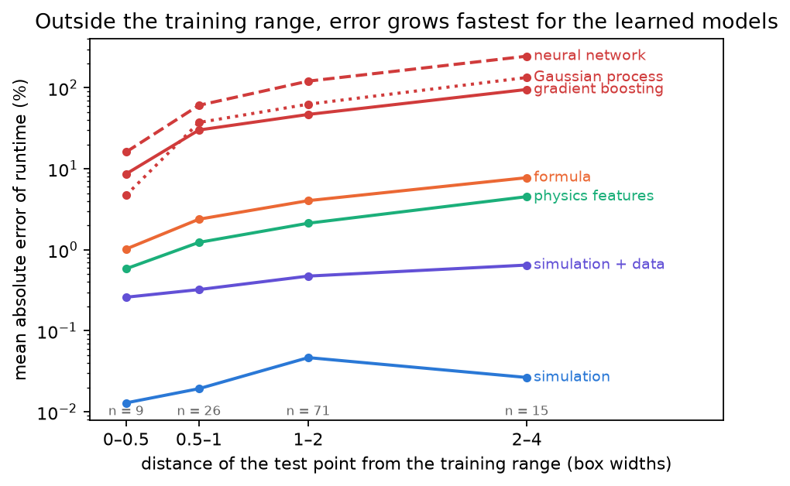
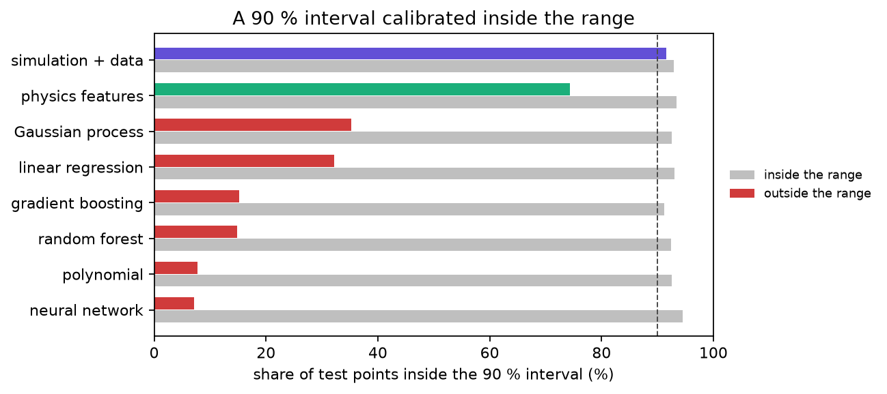
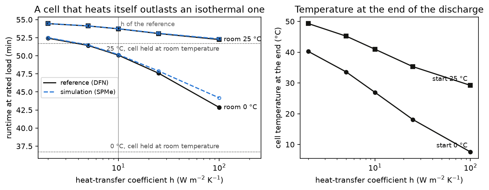
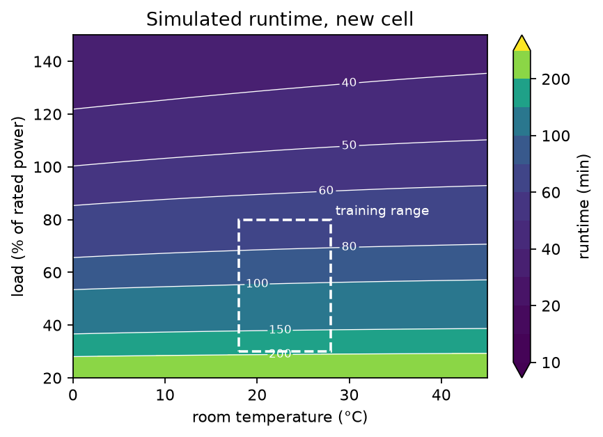
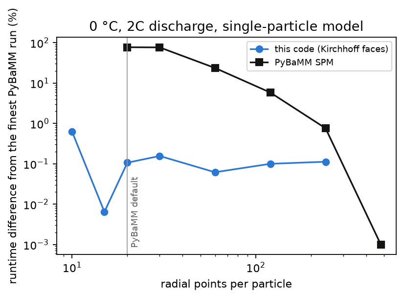

# UPS-Battery-Prediction

[](https://github.com/Shuruyue/UPS-Battery-Prediction/actions/workflows/ci.yml)


**[Interactive page](https://shuruyue.github.io/UPS-Battery-Prediction/web/ups-battery.html)**: set the room temperature, the load and the age of the battery and compare the runtime a formula, a simulation and five learned models predict, or put a cell in an oven and watch it run away. Inside the conditions they were trained on, gradient boosting, a neural network and a Gaussian process have mean runtime errors of 0.5–1.8 %; outside, their errors are 46–116 %, against 3.9 % for a two-point formula, and their 90 % intervals keep claiming 90 % confidence.

[](https://shuruyue.github.io/UPS-Battery-Prediction/web/ups-battery.html)

## Backup-battery prediction: formula, simulation, machine learning

How long will the battery of an uninterruptible power supply (UPS) last when the mains fail, and can it catch fire? This project answers the same questions with three kinds of tool and scores all of them against one reference, inside and outside the conditions the tools were built for.

| Tool | What it is here |
|---|---|
| Formula | Peukert's law through two rated points (25 °C, new cell, 50 % and 100 % load), as read from a datasheet |
| Simulation | A single-particle model with electrolyte (SPMe) and a lumped thermal model of an LG M50 cell (NMC811 / graphite-SiOx), written from scratch in NumPy, not fitted to any data |
| Machine learning | scikit-learn regressors trained on 150 noisy discharges from the normal operating range |
| Physics in the learning | a linear model on physics features (log load, log health, 1/T), and the simulation corrected by a small learned model |

The reference ("reality") is the Doyle–Fuller–Newman model with the same lumped thermal model, solved with [PyBaMM](https://pybamm.org) using the parameters of O'Regan et al. (2022). A separate four-reaction thermal-runaway model answers the second question.

## Main results

Example system: 56 cells in series, 1.02 kWh, rated load 18 W per cell (about 1 kW). Dividing energy by power gives 60.5 min; the reference gives 53.7 min at 25 °C and 50.1 min at 0 °C.

Mean absolute percentage error of the predicted runtime (20 random splits):

| Predictor | Inside the training range | Outside |
|---|---|---|
| Peukert formula | 0.8 % | 3.9 % |
| Simulation (SPMe + heat, no fitting) | 0.01 % | 0.04 % |
| Gradient boosting | 1.8 % | 46.5 % |
| Neural network | 1.7 % | 115.7 % |
| Gaussian process | 0.5 % | 61.8 % |
| Linear model on physics features | 0.3 % | 2.1 % |
| Simulation + data correction | 0.2 % | 0.4 % |

Training range: 18–28 °C, 30–80 % of rated load, 90–100 % state of health. "Outside" is the part of a box of 0–45 °C, 20–150 % load and 70–100 % health that lies outside the training range (121 points).

**The learned models do not know when they are wrong.** A 90 % conformal interval calibrated inside the training range covers 91–94 % of the inside test points and 7–35 % of the outside points for the six purely data-driven models. With the physics in the model the same procedure covers 74 % (physics features) and 92 % (simulation corrected by data).




**A cold room costs much less runtime than an isothermal model says.** Held at the room temperature, the reference lasts 36.7 min at 0 °C and rated load; a cell that heats itself (cooled by 10 W m⁻² K⁻¹ over its surface) lasts 50.1 min and ends at 27 °C. At 25 °C the difference is small: 53.7 min against 51.7 min, ending at 41 °C. How much the self-heating helps depends on how well the cabinet removes heat: 52.4 min with almost no cooling (2 W m⁻² K⁻¹), 42.9 min with strong cooling (100 W m⁻² K⁻¹). The earlier version of this project held the cell at the room temperature. Scored against the self-heating reference on the outside points, its single-particle model is off by 3.6 %, the same model with the electrolyte by 9.4 % (an isothermal cold cell at heavy load runs out of electrolyte salt in the SPMe, which the warming cell of the reference does not), and the model with the electrolyte and self-heating by 0.04 %. When the cell is kept cold (0 °C with strong cooling, or isothermal) the SPMe itself overestimates the DFN by 3.1–4.0 %; see [VALIDATION.md](VALIDATION.md).




**The simulation is favoured here.** It shares every parameter and most of the physics with the reference, so its 0.04 % is a best case, not an estimate of its error against a real cell. Setting one parameter group wrong (solid diffusivities, exchange currents or resistances by 30 %, or the cooling coefficient by a factor of two) moves its outside error to 0.1–2.8 %, and three groups at once to 3.2 % (`scripts/perturb_model.py`): the same order as the formula and the physics features. Against a real battery the parameters would also be uncertain, and physics that neither model contains would add to the error.

**Can it burn?** The hottest point of the design (45 °C, 147 % load, state of health 0.74) ends at 90 °C, well below the oven onset temperatures of the thermal-runaway model, whose cell (an 18650, not the LG M50) runs away above 146 °C with a LiCoO2 cathode, 166 °C with NMC111 and 206 °C with LiFePO4. The oven tests of Hatchard et al. (2001) on this LiCoO2 cell put the onset between 145 and 150 °C (no runaway at 145 °C, runaway at 150 and 155 °C; Lopez et al. 2015, Fig. 2a).




## Verification

| Check | Result |
|---|---|
| Parameter functions | every function of `params.py` equals PyBaMM's `ORegan2022` set (`tests/test_params.py`, run in CI with PyBaMM) |
| Same equations, two codes | our SPM, SPMe and SPMe + heat against PyBaMM's, with fixed settings for every case (no case is chosen afterwards); see [VALIDATION.md](VALIDATION.md) |
| Model form | SPMe + heat against DFN + heat within 1 % at 9–27 W, 0–25 °C |
| Numerics | second order in space against the series solution for a sphere and the closed-form steady electrolyte profile; lithium and salt conserved to round-off; grid and time-step convergence in the hardest corner of the design |
| Reference mesh | the hardest corners agree within 0.2 % on a mesh twice as fine |
| Thermal runaway | exact adiabatic energy balance; Semenov critical temperature; own implicit solver against SciPy's Radau |
| Interactive page | its JavaScript thermal-runaway model against the Python package, in Node.js on every CI run |

PyBaMM's SPMe evaluates the electrolyte conductivity and diffusion-potential factor at an x-averaged concentration that its discretisation reports as 1036 mol/m³ when the concentration is 1000 mol/m³ everywhere. The hand-written SPMe integrates the electrolyte potential with the local concentration instead; the code check therefore uses a parameter variant in which both properties do not depend on concentration, where the two forms are the same equations.



`python scripts/validate.py` runs every check on the stored results and fails on any miss; [VALIDATION.md](VALIDATION.md) lists them.

## Differences from standard practice

- The reference is a model, not a measurement, and it shares its parameters with the simulation (see above). No measured discharge data of the LG M50 at low temperature were used.
- The heat-transfer coefficient (10 W m⁻² K⁻¹, PyBaMM's value for this parameter set) is assumed for a cell inside a UPS cabinet, and the room temperature is held constant during the outage. Neighbouring cells, which warm each other, are not modelled in the runtime part.
- Ageing is represented as loss of lithium inventory plus an SEI film resistance; loss of active material, particle cracking and lithium plating are not.
- The UPS is reduced to one cell at constant power. Inverter efficiency, the spread between cells of a series string (the weakest cell reaches the cut-off first) and the battery-management system are not simulated.
- The measurement noise of the training data (2 %, log-normal) is assumed.
- The thermal-runaway part uses an 18650 LiCoO2 cell (Kim et al. 2007) because its abuse kinetics are published as a complete set; NMC111 and LiFePO4 change only the cathode reaction. It is lumped and has no venting, so onset temperatures and timing are its reliable outputs and peak temperatures run high.

## Quick start

```bash
git clone https://github.com/Shuruyue/UPS-Battery-Prediction.git
cd UPS-Battery-Prediction
pip install -e ".[dev]"            # add ",reference" for PyBaMM
pytest -q
python scripts/validate.py
python scripts/summary.py
```

```python
from ups_battery_prediction import discharge

r = discharge.simulate(273.15, soh=1.0, power=18.0)      # 0 °C, new cell, rated power, SPMe + heat
print(r["runtime_s"][0] / 60, r["T_max_K"][0] - 273.15)
```

## Reproduce

The results in `results/` come from these scripts, run from the repository root:

| Step | Command | Time |
|---|---|---|
| Mesh audit of the reference | `python scripts/audit_reference_mesh.py --workers 4` | ~1 h |
| Reference (418 DFN runs) | `python scripts/gen_reference.py --workers 4` | ~2 h with 4 workers |
| Own model at the design points and on a grid | `python scripts/gen_model_points.py`, `python scripts/gen_model_grid.py` | ~30 min |
| Code and model-form checks against PyBaMM | `python scripts/verify_pybamm.py` | ~40 min |
| Convergence, self-heating, sensitivity | `python scripts/convergence.py`, `python scripts/thermal_effect.py`, `python scripts/perturb_model.py` | ~1 h |
| Machine-learning experiment | `python scripts/run_ml.py` | ~1 h |
| Thermal runaway | `python scripts/verify_runaway.py`, `python scripts/run_runaway_scenarios.py` | ~20 min |
| Figures, page, validation table | `python scripts/make_figures.py`, `python scripts/build_web_page.py`, `python scripts/validate.py --markdown` | ~3 min |

Set `OMP_NUM_THREADS=1` when several scripts run at once. Each PyBaMM worker holds about 1.3 GB of memory; choose the number of workers from the free memory, not the number of cores.

## Project structure

```text
UPS-Battery-Prediction/
├── ups_battery_prediction/
│   ├── params.py           # LG M50 parameters (O'Regan 2022, Chen 2020, Landesfeind 2019)
│   ├── ageing.py           # state of a fully charged cell at a given state of health
│   ├── numerics.py         # particle and electrolyte finite volumes, tridiagonal solver
│   ├── discharge.py        # SPM / SPMe, isothermal / lumped, constant current or power
│   ├── thermal_runaway.py  # four-reaction abuse model, adaptive implicit integrator
│   ├── reference.py        # design of the experiment and the PyBaMM reference
│   ├── predictors.py       # Peukert, learned models, physics features, conformal intervals
│   ├── experiment.py       # formula vs simulation vs machine learning
│   ├── validation.py       # checks behind VALIDATION.md
│   ├── summary.py          # the numbers quoted in this README
│   └── plotting.py         # figures
├── scripts/                # command-line entry points (see Reproduce)
├── tests/                  # pytest
├── results/                # JSON output of the scripts
├── docs/figures/           # figures of this README
├── web/                    # interactive page (GitHub Pages); web/src holds its sources
└── VALIDATION.md
```

## References

1. K. O'Regan, F. Brosa Planella, W. D. Widanage, E. Kendrick, *Electrochim. Acta* **425**, 140700 (2022). [doi:10.1016/j.electacta.2022.140700](https://doi.org/10.1016/j.electacta.2022.140700) — LG M50 thermal-electrochemical parameters (CC BY 4.0).
2. C.-H. Chen et al., *J. Electrochem. Soc.* **167**, 080534 (2020). [doi:10.1149/1945-7111/ab9050](https://doi.org/10.1149/1945-7111/ab9050) — open-circuit potentials and geometry (CC BY 4.0).
3. J. Landesfeind, H. A. Gasteiger, *J. Electrochem. Soc.* **166**, A3079 (2019). [doi:10.1149/2.0571912jes](https://doi.org/10.1149/2.0571912jes) — electrolyte properties.
4. S. G. Marquis et al., *J. Electrochem. Soc.* **166**, A3693 (2019). [doi:10.1149/2.0341915jes](https://doi.org/10.1149/2.0341915jes) — SPMe.
5. F. Brosa Planella, M. Sheikh, W. D. Widanage, *Electrochim. Acta* **388**, 138524 (2021). [doi:10.1016/j.electacta.2021.138524](https://doi.org/10.1016/j.electacta.2021.138524) — integrated electrolyte potential, thermal reduced model.
6. V. Sulzer et al., *J. Open Res. Softw.* **9**, 14 (2021). [doi:10.5334/jors.309](https://doi.org/10.5334/jors.309) — PyBaMM.
7. T. D. Hatchard et al., *J. Electrochem. Soc.* **148**, A755 (2001). [doi:10.1149/1.1377592](https://doi.org/10.1149/1.1377592) — thermal model and oven tests of 18650 cells.
8. G.-H. Kim, A. Pesaran, R. Spotnitz, *J. Power Sources* **170**, 476 (2007). [doi:10.1016/j.jpowsour.2007.04.018](https://doi.org/10.1016/j.jpowsour.2007.04.018) — abuse kinetics and cell properties.
9. P. Peng, F. Jiang, *Int. J. Heat Mass Transfer* **103**, 1008 (2016). [doi:10.1016/j.ijheatmasstransfer.2016.07.088](https://doi.org/10.1016/j.ijheatmasstransfer.2016.07.088) — NMC111 and LiFePO4 cathode reactions.
10. C. F. Lopez, J. A. Jeevarajan, P. P. Mukherjee, *J. Electrochem. Soc.* **162**, A2163 (2015). [doi:10.1149/2.0751510jes](https://doi.org/10.1149/2.0751510jes) — oven tests of Hatchard et al. at 145–155 °C, h = 7.17 W m⁻² K⁻¹ (open access).
11. H. Chen et al., *J. Electrochem. Soc.* **168**, 010502 (2021). [doi:10.1149/1945-7111/abd64c](https://doi.org/10.1149/1945-7111/abd64c) — surface emissivity 0.8 of the 18650 cell, after Hatchard et al.

## License

MIT License. The cell parameters are transcribed from the CC BY 4.0 publications cited above.
