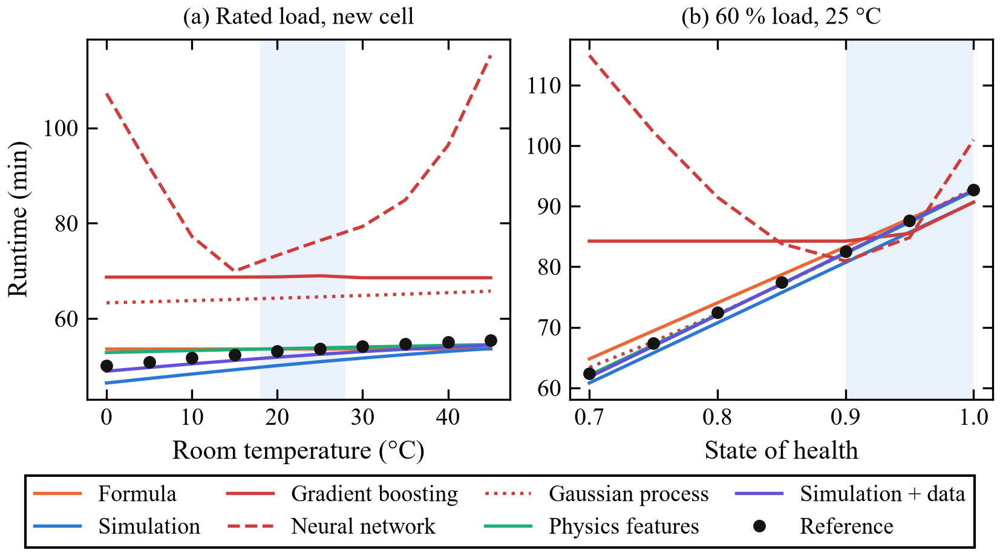

# Battery-Prediction

[](https://github.com/Shuruyue/Battery-Prediction/actions/workflows/ci.yml)


**[Interactive page](https://shuruyue.github.io/Battery-Prediction/web/battery.html)**: set the room temperature, the load and the age of the battery and compare the runtime that a formula, a simulation and five learned models predict. Inside the conditions they were trained on, gradient boosting, a neural network and a Gaussian process have mean runtime errors of 0.5–1.8 %; outside, their errors are 46–116 %, against 3.9 % for a two-point formula and 3.2 % for a simulation whose parameters are 30 % off, and their 90 % intervals keep claiming 90 % confidence.

[](https://shuruyue.github.io/Battery-Prediction/web/battery.html)

*Mean absolute error of the predicted runtime against the distance of the test point from the training range, pooled over 20 random splits. The learned models (red) are accurate inside the range and diverge outside it; the formula, the simulation and the two models with physics in them degrade slowly. The simulation runs with parameters 30 % off those of the reference.*

## Battery Runtime Inside and Outside the Training Range

How long will a battery last at constant power? A predictor is usually built and tested under normal conditions, but the day it matters may be colder or hotter, the cells older and the load heavier than planned. This project scores three kinds of predictor, a formula, a physical simulation and machine learning, against one reference, inside the normal operating range on which the learned models are trained and outside it.

The reference ("reality") is the Doyle–Fuller–Newman (DFN) model with a lumped thermal model, solved with [PyBaMM](https://pybamm.org) using the LG M50 parameters of O'Regan et al. (2022). The simulation is a reduced model of the same cell written from scratch here; since the parameters of a real cell are never known exactly, it runs with a deliberately wrong set. Every result quoted below is computed by `battery_prediction/summary.py` from `results/*.json`, and `scripts/validate.py` checks that the README still quotes what the results give.

Temperatures are in °C, loads are shares of the rated 18 W per cell, runtimes are in minutes, and the state of health (SOH) is the low-rate capacity as a share of that of the new cell.

## Project Overview

### Core Features

- **Reference** — PyBaMM DFN with a lumped thermal model at 418 operating points: a Sobol design of the normal range, a Sobol design of a wider box and four one-at-a-time sweeps, on a mesh chosen by an audit.
- **Simulation** — single-particle model with electrolyte (SPMe) and the same lumped thermal model, written from scratch in NumPy: finite volumes with Kirchhoff-transform face diffusivities, many operating points per solve, constant power by Newton iteration. Checked against PyBaMM on the same equations; in the experiment it runs with three parameter groups 30 % off.
- **Formula** — Peukert's law through two rated points, as read from a datasheet.
- **Machine learning** — gradient boosting, a neural network and a Gaussian process (scikit-learn) trained on 150 noisy discharges from the normal range, a linear model on physics features and the simulation corrected by data; split-conformal 90 % intervals; 20 random splits.
- **Ageing** — loss of lithium inventory to the SEI, with the film resistance it adds.
- **Validation** — 22 automated checks and 2 reported observations, plus unit tests, run in CI on every push.

## Quick Start

### Installation

```bash
git clone https://github.com/Shuruyue/Battery-Prediction.git
cd Battery-Prediction
pip install -e ".[dev]"            # add ",reference" for PyBaMM, needed only to regenerate the reference
```

### Usage

```bash
python scripts/summary.py         # the main results, computed from results/*.json
python scripts/make_figures.py    # all figures → docs/figures/
```

```python
from battery_prediction import discharge

r = discharge.simulate(273.15, soh=1.0, power=18.0)     # 0 °C, new cell, rated power, SPMe + heat
print(r["runtime_s"][0] / 60, r["T_max_K"][0] - 273.15) # 50.17  25.71
```

### Validation Scripts

```bash
pytest -q                               # unit tests; parameters against PyBaMM when it is installed
python scripts/validate.py --markdown   # checks on results/*.json and README.md → VALIDATION.md
```

`scripts/validate.py` exits with code 1 if any check fails. The full table is in [VALIDATION.md](VALIDATION.md).

### Reproducing the results

The results in `results/` come from these scripts, run from the repository root. They were produced with PyBaMM 26.10.1.1.

| Step | Command | Time |
|---|---|---|
| Mesh audit of the reference | `python scripts/audit_reference_mesh.py --workers 4` | ~1 h |
| Reference (418 DFN runs) | `python scripts/gen_reference.py --workers 4` | ~2 h with 4 workers |
| Code and model-form checks against PyBaMM | `python scripts/verify_pybamm.py` | ~40 min |
| Convergence and self-heating | `python scripts/convergence.py`, `python scripts/thermal_effect.py` | ~45 min |
| Simulation at the design points | `python scripts/gen_model_points.py` | ~6 min |
| Machine-learning experiment | `python scripts/run_ml.py --workers 6` | ~1 min |
| Parameter sensitivity | `python scripts/perturb_model.py --workers 4` | ~20 min with 4 workers |
| Simulation on the grid of the interactive page | `python scripts/gen_model_grid.py` | ~35 min |
| Figures, page, validation table | `python scripts/make_figures.py`, `python scripts/build_web_page.py`, `python scripts/validate.py --markdown` | ~2 min |

Set `OMP_NUM_THREADS=1` when several scripts run at once. Each PyBaMM worker holds about 1.3 GB of memory; choose the number of workers from the free memory, not the number of cores.

## Project Structure

```text
Battery-Prediction/
├── battery_prediction/
│   ├── params.py           # LG M50 parameters (O'Regan 2022, Chen 2020, Landesfeind 2019)
│   ├── ageing.py           # state of a fully charged cell at a given state of health
│   ├── numerics.py         # particle and electrolyte finite volumes, tridiagonal solver
│   ├── discharge.py        # SPM / SPMe, isothermal / lumped, constant current or power
│   ├── design.py           # operating points of the experiment, parameters of the simulation tool
│   ├── reference.py        # the PyBaMM reference (DFN + lumped thermal)
│   ├── results.py          # reading and writing results/*.json
│   ├── predictors.py       # Peukert, learned models, physics features, conformal intervals
│   ├── experiment.py       # formula vs simulation vs machine learning
│   ├── validation.py       # checks behind VALIDATION.md (run_all)
│   ├── summary.py          # every number quoted in this README (compute)
│   └── plotting.py         # figures (14 cm wide, 300 dpi)
├── scripts/                # command-line entry points (see Reproducing the results)
├── tests/                  # pytest
├── results/                # JSON output of the scripts
├── docs/figures/           # figures of this README
├── web/                    # interactive page (GitHub Pages); web/src holds its sources
└── VALIDATION.md           # check-by-check validation table
```

## Theoretical Background

### Single-particle model with electrolyte (SPMe)

Each electrode $k$ is represented by one spherical particle in which lithium diffuses; $`\theta_k = c_k/c_{k,\max}`$ is its stoichiometry:

```math
\frac{\partial \theta_k}{\partial t} = \frac{1}{r^2}\frac{\partial}{\partial r}\left(r^2 D_k(\theta_k,T)\,\frac{\partial \theta_k}{\partial r}\right),\qquad
-D_k\frac{\partial \theta_k}{\partial r}\bigg|_{r=R_k} = \pm\frac{I}{F\,a_k L_k A\,c_{k,\max}}
```

(+ for the negative electrode, which gives up lithium during discharge). The salt concentration across the cell follows

```math
\varepsilon\frac{\partial c_e}{\partial t} = \frac{\partial}{\partial x}\left(\varepsilon^{b} D_e(c_e,T)\,\frac{\partial c_e}{\partial x}\right) + \frac{1}{F}\frac{\partial}{\partial x}\Big[\big(1-t^{+}(c_e,T)\big)\,i_e\Big],
```

where the electrolyte current density $`i_e`$ rises linearly from 0 to $I/A$ across the negative electrode, is $I/A$ in the separator and falls back to 0 across the positive electrode: the reaction is spread evenly over each electrode, which is the single-particle assumption. The terminal voltage is

```math
V = U_p(\theta_{p,s},T) - U_n(\theta_{n,s},T) - \bar\eta_n - \bar\eta_p + \Delta\phi_e + \Delta\phi_s - I R_\mathrm{film}
```

```math
\eta_k = \frac{2RT}{F}\,\mathrm{asinh}\frac{I/(a_k L_k A)}{2\,j_{0,k}(\theta_{k,s},c_e,T)},\qquad
\frac{\partial\phi_e}{\partial x} = \chi(c_e,T)\,\frac{RT}{F}\,\frac{\partial\ln c_e}{\partial x} - \frac{i_e}{\varepsilon^{b}\kappa_e(c_e,T)},\qquad
\Delta\phi_s = -\frac{I}{A}\left(\frac{L_n}{3\sigma_n}+\frac{L_p}{3\sigma_p}\right)
```

with $`\chi = 2(1-t^{+})(1+\mathrm{d}\ln f/\mathrm{d}\ln c)`$, the overpotentials $`\bar\eta_k`$ averaged over each electrode, $`\Delta\phi_e`$ the mean electrolyte potential of the positive electrode minus that of the negative one, and $`U(\theta,T) = U_\mathrm{ref}(\theta) + (T-T_\mathrm{ref})\,\partial U/\partial T`$. Diffusivities, exchange currents and the positive-electrode conductivity follow Arrhenius laws (Marquis et al. 2019; O'Regan et al. 2022). The electrolyte potential is integrated with $`\chi`$ and $`\kappa_e`$ at the local concentration, the "integrated" form of Brosa Planella et al. (2021); PyBaMM's SPMe evaluates both at the x-averaged concentration, so the code check against PyBaMM uses a parameter variant in which neither depends on concentration, where the two forms are the same equations.

### Lumped thermal model

```math
C(T)\,\frac{dT}{dt} = I\,(U_p-U_n-V) + I\,T\left(\frac{\partial U_n}{\partial T}-\frac{\partial U_p}{\partial T}\right) - hA_\mathrm{cool}\,(T-T_\mathrm{amb})
```

The first term is all irreversible heat (reaction, ohmic, electrolyte polarisation, SEI film), the second the reversible (entropic) heat; $`C = \rho c_{p,\mathrm{eff}}(T)\,V_\mathrm{cell}`$ as in PyBaMM's lumped model. The cell starts at the ambient temperature. The isothermal model, which holds the cell at the ambient temperature, is the limit $`h\to\infty`$.

### Numerics

Finite volumes with 30 cells per particle and 20/10/20 cells across the negative electrode, separator and positive electrode; backward-Euler steps of 1 s with the coefficients of the previous step, so that the current of a constant-power step follows from Newton iteration on $`I\,V(I) = P`$. Both solid diffusivities change by orders of magnitude within narrow stoichiometry windows; face diffusivities from the Kirchhoff transform $`\Phi(\theta) = \int_0^{\theta} D_\mathrm{ref}\,d\theta'`$ give the exact flux of a steady front between two cells and keep the model converged on a coarse grid ([VALIDATION.md](VALIDATION.md), Convergence).

### Ageing

Ageing is loss of lithium inventory (LLI) to the SEI on the negative electrode, the dominant mode for cells kept on float charge at moderate temperature. The lost lithium thickens the SEI (two Li per SEI molecule), which adds a film resistance in series:

```math
n_\mathrm{Li} = (1-\mathrm{LLI})\,n_\mathrm{Li,new},\qquad
\delta_\mathrm{SEI} = \delta_0 + \frac{\mathrm{LLI}\;n_\mathrm{Li,new}\,\bar V_\mathrm{SEI}}{2\,a_n L_n A},\qquad
R_\mathrm{film} = \frac{\rho_\mathrm{SEI}\,\delta_\mathrm{SEI}}{a_n L_n A}
```

LLI is chosen so that the low-rate capacity between full charge (the open-circuit voltage of the new cell) and 2.5 V is SOH times that of the new cell.

### Formula and learned models

Peukert's law with a capacity factor, $`t = t_\mathrm{rated}\,\mathrm{SOH}\,L^{-k}`$, with $`t_\mathrm{rated}`$ and $k$ from the reference at 25 °C, new cell, 50 % and 100 % load. The physics features fit $`\ln t = a + b\ln L + c\ln\mathrm{SOH} + d/T`$ by least squares; the simulation corrected by data is $`t = t_\mathrm{sim}\exp g(T,L,\mathrm{SOH})`$ with $g$ a ridge regression fitted to $`\ln(t_\mathrm{meas}/t_\mathrm{sim})`$. The training "measurements" are reference runtimes with 2 % log-normal noise. Each of 20 random splits takes 56 test, 150 training and 50 calibration points from the normal range.

The 90 % intervals are split-conformal (Lei et al. 2018) on the relative residual:

```math
r_i = \frac{|y_i-\hat y_i|}{\hat y_i}\ \text{on } n = 50 \text{ calibration points},\qquad
q = r_{(k)},\quad k = \lceil (n+1)(1-\alpha)\rceil = 46,\qquad
\text{interval } \hat y\,(1\pm q)
```

For a new point exchangeable with the calibration points the coverage is $k/(n+1) = 46/51 = 0.902$. Points outside the training range are not exchangeable with them, and nothing guarantees coverage there.

## Parameters

| Parameter | Value | Source |
|---|---|---|
| Cell | LG M50, 21700, NMC811 / graphite-SiOx, 5 A h | [1, 2] |
| Parameter functions (OCPs, diffusivities, exchange currents, conductivities, entropic coefficients, heat capacities) | PyBaMM's `ORegan2022` set, every function checked by `tests/test_params.py` | [1, 2, 3] |
| Electrode / separator thickness | 85.2 / 12 / 75.6 µm | [2] |
| Particle radius, negative / positive | 5.86 / 5.22 µm | [2] |
| Electrolyte | LiPF6 in EC:EMC 3:7 | [3] |
| Lower cut-off voltage | 2.5 V | [1] |
| Heat-transfer coefficient $h$ | 10 W m⁻² K⁻¹ | PyBaMM's value for this set; assumed for a cell in a battery cabinet |
| Cooling area, cell volume | 53.1 cm², 24.2 cm³ | [1] |
| SEI molar volume, resistivity, initial thickness | 9.585 × 10⁻⁵ m³ mol⁻¹, 2 × 10⁵ Ω m, 5 nm | PyBaMM's `Chen2020` set, after [7] |
| Parameters of the simulation tool | solid diffusivities and exchange currents × 0.7, resistances × 1.3 of the above | assumed, pessimistic; the checks against PyBaMM use the exact set |
| Rated load | 18 W per cell (56 cells in series, about 1 kW) | assumed example pack |
| Training range of the learned models | 18–28 °C, 30–80 % load, SOH 0.9–1.0 | design of this study |
| Wider box | 0–45 °C, 20–150 % load, SOH 0.7–1.0 | design of this study |
| Measurement noise of the training data | 2 %, log-normal | assumed |

## Key Results

Example pack: 56 cells in series, 1.02 kWh, rated load 18 W per cell (about 1 kW). Dividing energy by power gives 60.5 min; the reference gives 53.7 min at 25 °C and 50.1 min at 0 °C.

Mean absolute percentage error of the predicted runtime (20 random splits):

| Predictor | Inside the training range | Outside |
|---|---|---|
| Peukert formula | 0.8 % | 3.9 % |
| Simulation (SPMe + heat, parameters 30 % off, no fitting) | 2.2 % | 3.2 % |
| Gradient boosting | 1.8 % | 46.5 % |
| Neural network | 1.7 % | 115.7 % |
| Gaussian process | 0.5 % | 61.8 % |
| Linear model on physics features | 0.3 % | 2.1 % |
| Simulation + data correction | 0.3 % | 1.0 % |

"Outside" is the part of the wider box that lies outside the training range (121 points).

**The learned models do not know when they are wrong.** A 90 % conformal interval calibrated inside the training range covers 89–92 % of the inside test points and 6–34 % of the outside points for the three learned models. With physics in the model the same procedure covers 71 % (physics features) and 85 % (simulation corrected by data).


*Share of the test points inside the 90 % conformal interval, mean of 20 random splits. Grey: inside the training range, where every model reaches the nominal coverage; coloured: outside it. Dashed: 90 %.*



*Reference (dots) and the predictions of one split along (a) the temperature sweep at rated load and (b) the state-of-health sweep at 60 % load and 25 °C. Shaded: the training range.*

**Physics carries a model outside the range, even with wrong parameters.** With the reference's exact parameters the simulation's outside error would be 0.04 %, a best case, since the two models then share every parameter; with one parameter group wrong (solid diffusivities, exchange currents or resistances by 30 %, or the cooling coefficient by a factor of two) it is 0.1–2.8 % (`scripts/perturb_model.py`). Trained on top of any of these simulations, the data correction keeps the outside error at or below 1.1 %, and its 90 % intervals cover 84–89 % of the outside points.

**A cold room costs much less runtime than an isothermal model says.** Held at the room temperature, the reference lasts 36.7 min at 0 °C and rated load; a cell that heats itself (cooled by 10 W m⁻² K⁻¹ over its surface) lasts 50.1 min and ends at 27 °C. At 25 °C the difference is small: 53.7 min against 51.7 min, ending at 41 °C. How much the self-heating helps depends on how well the cabinet removes heat: 52.4 min with almost no cooling (2 W m⁻² K⁻¹), 42.9 min with strong cooling (100 W m⁻² K⁻¹).


*(a) Runtime of a new cell at rated load against the heat-transfer coefficient $h$, reference (DFN, black) and SPMe (blue), both with the reference's parameters; ∞ is the isothermal model. (b) Cell temperature at the end of the discharge in the reference.*

## Validation

| Category | Checks | Examples |
|---|---|---|
| Reference | 3 | mesh audit: twice the radial and twice the through-cell resolution change the hardest corners by less than 0.2 %; all 418 points solved to 2.5 V |
| Code check against PyBaMM | 7 | our SPM, SPMe and SPMe + heat against PyBaMM's on the same equations and parameters, 6 cases C/2–2C, −10 to 25 °C: voltage RMS < 5 mV, runtime < 0.5 %, end temperature < 0.1 K |
| Model form | 1 | SPMe + heat against DFN + heat within 1 % at 9–27 W, 0–25 °C |
| Convergence | 5 | radial grid against PyBaMM's finest; radial, through-cell and time-step refinement in the hardest corner of the design |
| Self-heating | 2 (+ 2 observations) | SPMe against the reference at the reference's cooling; the gain from self-heating at 0 °C |
| Experiment | 3 | conformal coverage inside the range; Peukert through its two points; size of the design |
| README | 1 | every number of `summary.compute` appears verbatim in this README |

Unit tests (`pytest`) check the building blocks separately: diffusion in a sphere against the series solution and the steady electrolyte profile against the closed form (both second order in space), conservation of lithium and salt to round-off, the SPMe-to-SPM limit, every parameter function against PyBaMM, the rank and coverage of the conformal interval, and the data of the interactive page against the results.

## Limitations

- The reference is a model, not a measurement. The simulation shares its particle and heat equations with it, and the wrong parameter set stands only for uncertain parameters: physics that neither model contains would add to the error against a real cell. No measured discharge data of the LG M50 at low temperature were used.
- The heat-transfer coefficient (10 W m⁻² K⁻¹, PyBaMM's value for this parameter set) is assumed for a cell inside a battery cabinet, and the room temperature is held constant during the discharge. Neighbouring cells, which warm each other, are not modelled.
- The formula is calibrated on the noise-free reference at 100 % load, which lies outside the training range of the learned models, as a datasheet point would; part of its advantage outside the range comes from that point.
- Ageing is loss of lithium inventory plus an SEI film resistance; loss of active material, particle cracking and lithium plating are not represented. All the lost lithium goes into the SEI, which at a state of health of 0.7 makes the film 0.81 µm thick with a resistance of 48 mΩ; measured SEI films are tens of nanometres thick, so the film stands for all the resistance growth of the aged cell rather than for a real layer.
- The battery is reduced to one cell at constant power. Converter efficiency, the spread between the cells of a series string (the weakest cell reaches the cut-off first) and the battery-management system are not simulated.
- The measurement noise of the training data (2 %, log-normal) is assumed.

## References

1. K. O'Regan, F. Brosa Planella, W. D. Widanage, E. Kendrick, *Electrochim. Acta* **425**, 140700 (2022). [doi:10.1016/j.electacta.2022.140700](https://doi.org/10.1016/j.electacta.2022.140700) — LG M50 thermal-electrochemical parameters (CC BY 4.0).
2. C.-H. Chen et al., *J. Electrochem. Soc.* **167**, 080534 (2020). [doi:10.1149/1945-7111/ab9050](https://doi.org/10.1149/1945-7111/ab9050) — open-circuit potentials and geometry (CC BY 4.0).
3. J. Landesfeind, H. A. Gasteiger, *J. Electrochem. Soc.* **166**, A3079 (2019). [doi:10.1149/2.0571912jes](https://doi.org/10.1149/2.0571912jes) — electrolyte properties.
4. S. G. Marquis et al., *J. Electrochem. Soc.* **166**, A3693 (2019). [doi:10.1149/2.0341915jes](https://doi.org/10.1149/2.0341915jes) — SPMe.
5. F. Brosa Planella, M. Sheikh, W. D. Widanage, *Electrochim. Acta* **388**, 138524 (2021). [doi:10.1016/j.electacta.2021.138524](https://doi.org/10.1016/j.electacta.2021.138524) — integrated electrolyte potential, thermal reduced model.
6. V. Sulzer et al., *J. Open Res. Softw.* **9**, 14 (2021). [doi:10.5334/jors.309](https://doi.org/10.5334/jors.309) — PyBaMM.
7. M. Safari, M. Morcrette, A. Teyssot, C. Delacourt, *J. Electrochem. Soc.* **156**, A145 (2009). [doi:10.1149/1.3043429](https://doi.org/10.1149/1.3043429) — SEI film properties.
8. J. Lei, M. G'Sell, A. Rinaldo, R. J. Tibshirani, L. Wasserman, *J. Am. Stat. Assoc.* **113**, 1094 (2018). [doi:10.1080/01621459.2017.1307116](https://doi.org/10.1080/01621459.2017.1307116) — split-conformal prediction intervals.

## License

MIT License. The cell parameters are transcribed from the CC BY 4.0 publications cited above.
